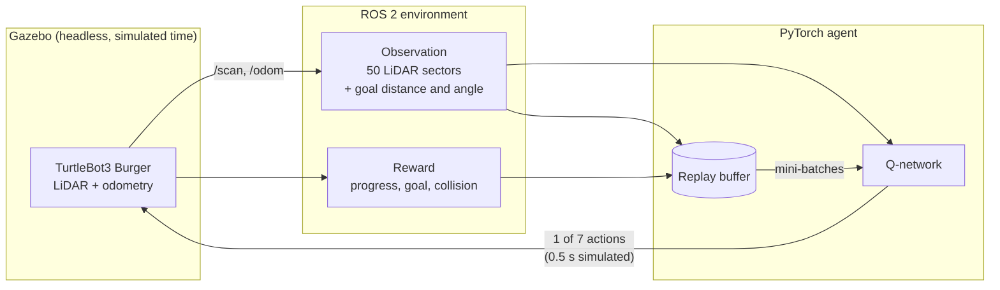

<div align="center">

# Deep Reinforcement Learning for TurtleBot3 Autonomous Navigation


### Learning to navigate without a map: deep reinforcement learning for a TurtleBot3

*LiDAR in, velocity out. No map, no planner. The robot learns goal navigation among static and moving
obstacles by trial and error.*

[](https://docs.ros.org/en/humble/)
[](https://classic.gazebosim.org/)
[](https://pytorch.org/)
[](https://www.python.org/)
[](LICENSE)
[](https://doi.org/10.5281/zenodo.24313470)


[Overview](#-overview) • [Features](#-features) • [How it works](#-how-it-works) •
[Getting started](#-getting-started) • [Layout](#-repository-layout) • [Earlier work](#-earlier-work)

</div>

---

## 🧭 Overview

A **TurtleBot3 Burger** in **Gazebo** has to reach goals it has never been told how to reach. It gets
only a 2D LiDAR scan and the direction and distance to its goal, and it picks one of a few velocity commands at
each step. Everything else, from avoiding walls to slipping past moving obstacles, it has to **learn
from reward alone**.

The repository is a complete research pipeline built around that task: learning agents written from scratch in
PyTorch, a Gazebo environment that runs faster than real time, parallel headless simulation,
reproducible run tracking and the statistics used for analysis.

> [!NOTE]
> This is an **active research project**. The code is public; the study design, results and paper will
> be released when the work is published.

## ✨ Features

<table>
<tr>
<td width="50%" valign="top">

**🧠 Learning agents from scratch**<br>
DQN-family agents implemented in PyTorch, all using one environment and one training loop, so the
comparison is fair.

</td>
<td width="50%" valign="top">

**⚡ Faster than real time, same physics**<br>
Simulated-time stepping speeds training up and is checked against real-time control: the robot ends
in the same place either way.

</td>
</tr>
<tr>
<td valign="top">

**🖥️ Parallel headless simulation**<br>
Several isolated Gazebo instances train side by side on one machine, with restartable job queues
that can be split across machines.

</td>
<td valign="top">

**🌍 Multiple worlds**<br>
From simple walled arenas to moving obstacles. Every episode starts in the same state, so runs are
reproducible.

</td>
</tr>
<tr>
<td valign="top">

**🔁 Reproducible by design**<br>
Every run records its seed, git commit, machine, device and settings, so any result can be traced
back.

</td>
<td valign="top">

**📊 Statistics tools**<br>
Wilson intervals, IQM, bootstrap confidence intervals, Vargha-Delaney effect sizes and exact
permutation tests with Holm correction.

</td>
</tr>
</table>

## ⚙️ How it works



| | |
|---|---|
| **Observation** | 52 values: 50 LiDAR sectors, goal distance, goal angle |
| **Actions** | 7 discrete velocity commands, each held for 0.5 s of simulated time |
| **Reward** | Progress toward the goal, bonus for reaching it, penalty for collision |
| **Episode start** | Simulation reset, fixed warm-up, robot placed at the start |
| **Timing** | Physics paused while the agent learns, so learning speed never changes the robot's motion |

## 🚀 Getting started

**Requirements:** Ubuntu 22.04 · ROS 2 Humble · Gazebo Classic 11 · TurtleBot3 packages · Python 3.10 with
PyTorch (a CUDA GPU is recommended)

```bash
# 1. Build (the repo root is the colcon workspace)
git clone https://github.com/shahedtheboss/turtle-bot-research.git ~/turtle-bot-research
cd ~/turtle-bot-research
source /opt/ros/humble/setup.bash
colcon build --symlink-install
source install/setup.bash
```

```bash
# 2. Run the unit tests
PYTEST_DISABLE_PLUGIN_AUTOLOAD=1 python3 -m pytest dqn_comparison/test/ -q \
  --ignore=dqn_comparison/test/test_flake8.py --ignore=dqn_comparison/test/test_pep257.py
```

```bash
# 3. Short training run in an isolated headless Gazebo slot
#    (slot 1, world 4, agent D3QN, seed 9, 3 episodes)
EVAL_REPEATS=1 scripts/run_slot_v2.sh 1 4 d3qn 9 --episodes 3 --eval-every 3 \
  --results-dir results_smoke/try --overwrite
```

## 📁 Repository layout

```text
turtle-bot-research/
├── dqn_comparison/                 ROS 2 package
│   ├── dqn_comparison/
│   │   ├── environment.py          Gazebo environment: observations, actions, reward, timing
│   │   ├── agent_*.py              learning agents
│   │   ├── rainbow_core.py         network and replay components
│   │   ├── learning.py             agent registry, episode loop, checkpoints
│   │   ├── train_v2.py             training entry point
│   │   ├── evaluate_v2.py          evaluation entry point
│   │   ├── worlds_v2.py            world layouts
│   │   ├── episode_v2.py           episode start
│   │   └── metrics_v2.py, stats.py metrics and statistics
│   └── test/                       unit tests
├── scripts/                        parallel Gazebo launchers and checks
└── docs/                           setup notes
```

## 📜 Earlier work

The first study (one world, one fixed goal) is on the [`version-1`](../../tree/version-1) branch, with its
code, results and paper. Its archived release is on Zenodo:
[10.5281/zenodo.24313470](https://doi.org/10.5281/zenodo.24313470).

## 📄 License

Released under the [MIT License](LICENSE).

<div align="center">
<sub>Built with ROS 2, Gazebo and PyTorch.</sub>
</div>
