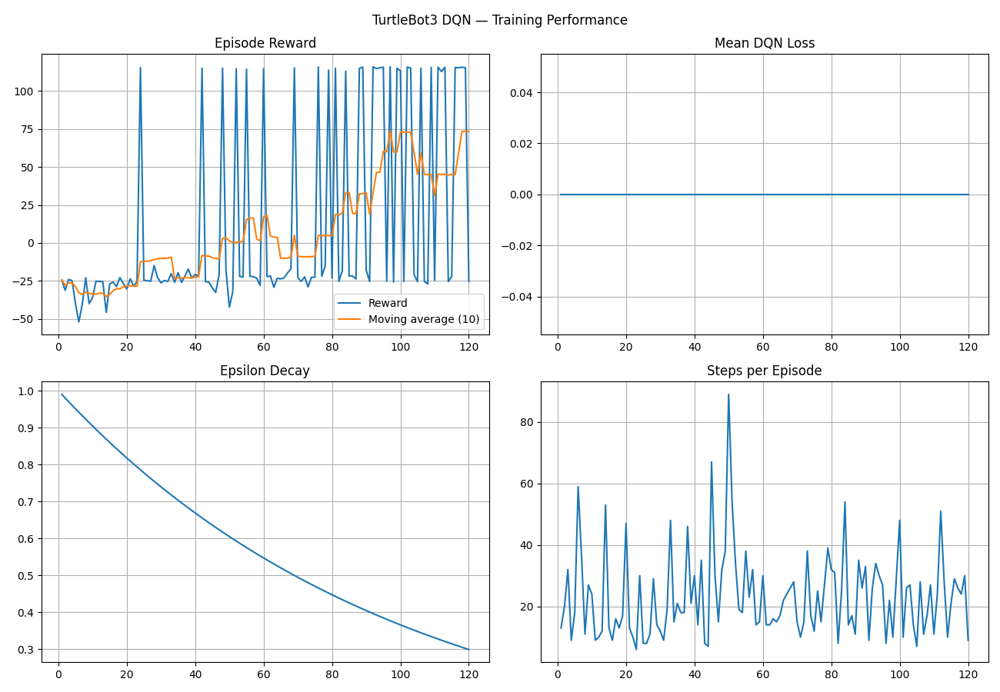
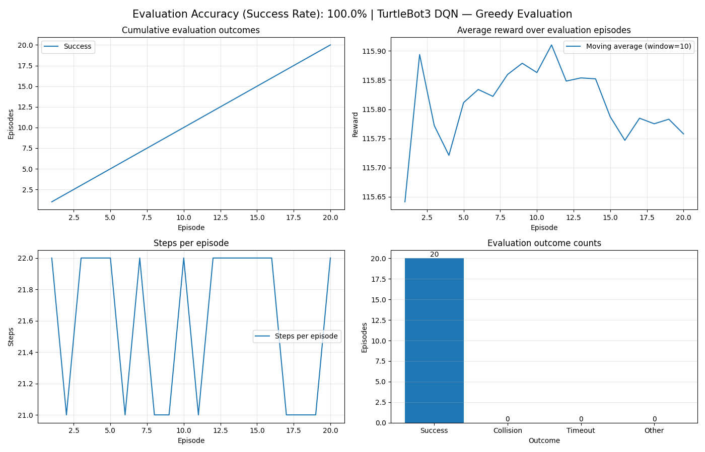
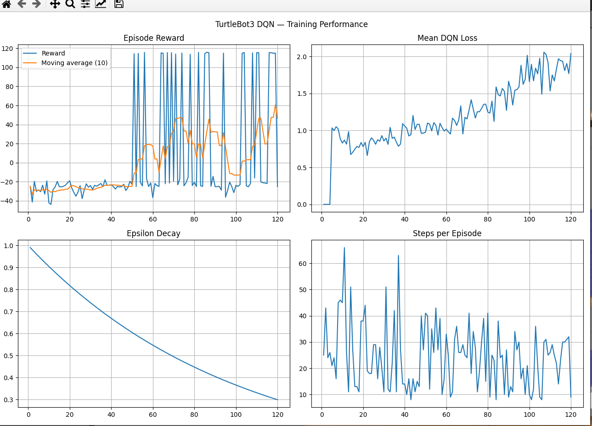
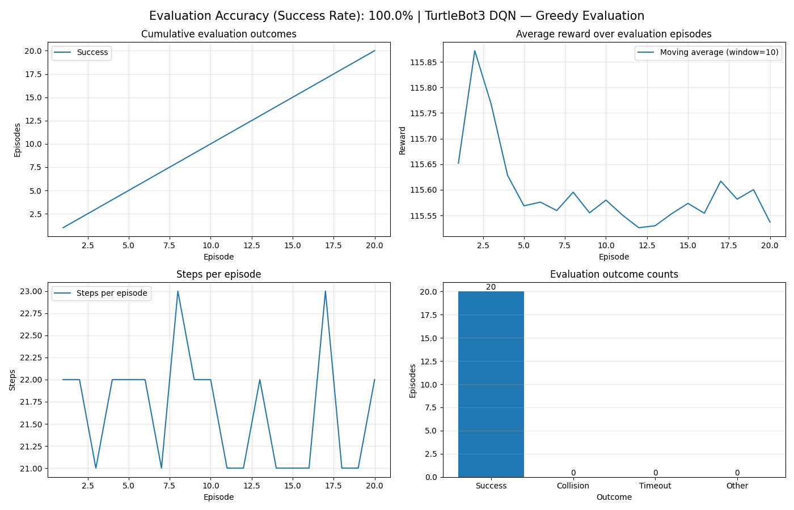
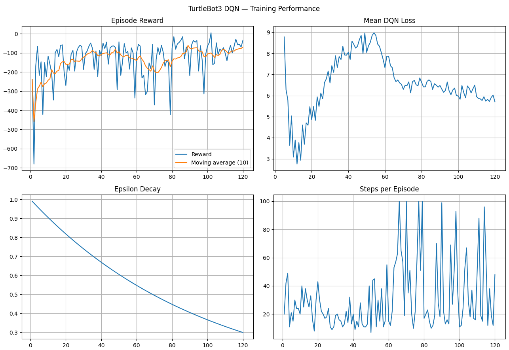
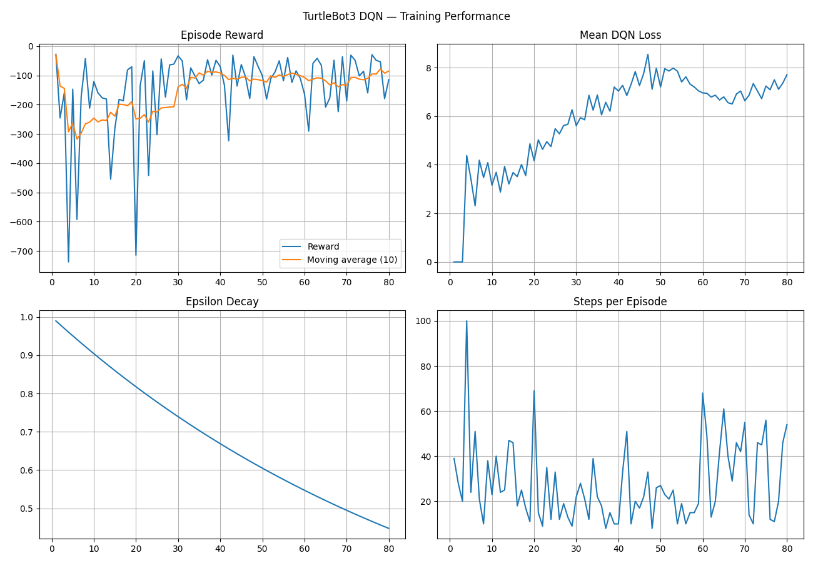
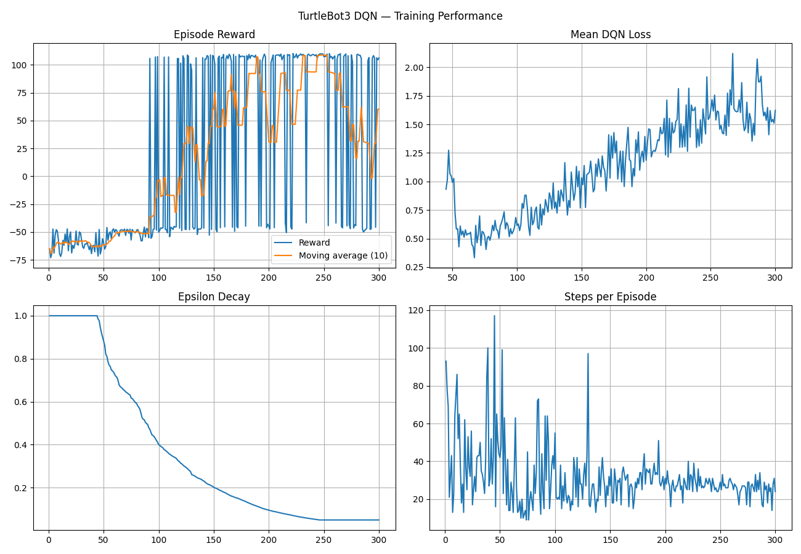
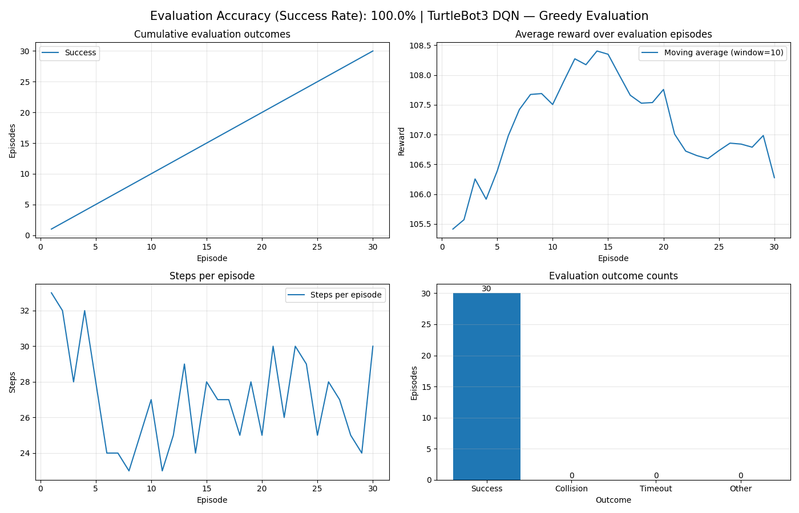
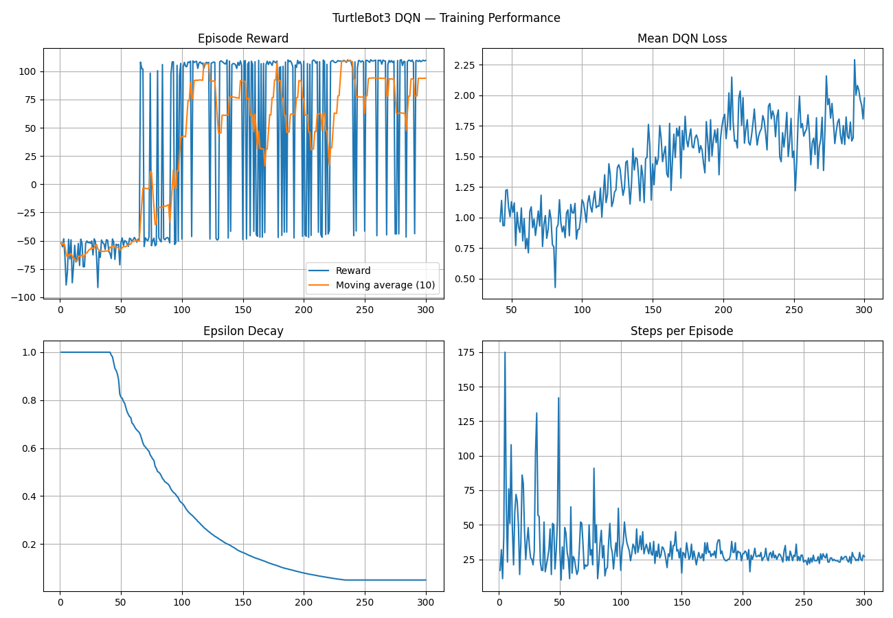

# TurtleBot3 DQN Navigation — Project Change Log

**Project:** Deep Reinforcement Learning for TurtleBot3 Autonomous Navigation  
**Platform:** ROS 2 Humble, Gazebo, TurtleBot3 Burger, Python, PyTorch  
**Research goal:** Develop and evaluate an improved DQN-based mobile robot navigation system.

## 1. Initial implementation and first evaluation

I developed an independent ROS 2 navigation implementation using the original DQN navigation project as a reference.

The initial implementation included:

- A custom robot environment communicating through `/scan`, `/odom`, and `/cmd_vel`.
- A seven-dimensional observation consisting of five LiDAR sectors, goal distance, and relative goal angle.
- A fixed navigation goal at `(2.0, -2.0)`.
- Five discrete actions for forward movement and turning.
- A DQN agent with a fully connected neural network containing two hidden layers of 128 neurons each.
- Experience replay, a policy network, a target network, epsilon-greedy exploration, and a training loop.
- Separate training and evaluation scripts.

The initial model was evaluated using greedy action selection, with exploration disabled during evaluation. The evaluation script recorded episode outcomes, rewards, and episode lengths and generated plots.

**Baseline configuration**

- Network: `7 → 128 → 128 → 5`
- Replay buffer capacity: 10,000 transitions
- Batch size: 64
- Optimizer: Adam
- Learning rate: 0.001
- Discount factor: 0.99
- Loss: Smooth L1 (Huber) loss
- Target network: hard update every two episodes
- Initial epsilon: 1.0
- Minimum epsilon: 0.05
- Epsilon decay: 0.99 per episode

The original five-action model and its checkpoint were retained as the baseline for subsequent comparisons.

 ### Bug = Bot was taking repeated reverse actions and finishing episodes wiht step expiring during evaluation --- Fixed by removing reverse intially

## 2. Environment and reward design

The custom environment uses five LiDAR sectors: front, front-left, front-right, left, and right. The nearest reading within each sector is used to represent nearby obstacles.

The reward and termination configuration includes:

- Goal-reaching reward: `+100`
- Obstacle-proximity termination penalty: `-30` (changed from -100 to fix goals to reach in obstucted paths)
- Per-step penalty: `-0.1`
- Progress reward: `+7 × distance progress` 
## Bug-- repeatedly bumping into corners fixed by changing intial +5 to +7
- Goal tolerance: approximately `0.20 m`
- LiDAR collision-warning threshold: changed from `0.20 m` to approximately `0.08 m`

The collision-warning threshold is a LiDAR-based termination rule; it does not actively prevent the robot from approaching an obstacle. It should not be described as a physical collision detector or a safety controller.

The goal remains fixed for the current experiments. Variable goals have not been included in the present scope.
Train Results:

Eval:

## 3. Recent DQN upgrades

After establishing the initial baseline, I began modifying the learning algorithm and model configuration.

### 3.1 Neural network architecture

The original network used two hidden layers of 128 neurons each. The network architecture was subsequently modified to increase model capacity.

The revised configuration was intended to use two hidden layers of 256 neurons each:

`7 → 256 → 256 → 7`

The output layer has seven neurons because the action space was expanded to seven discrete actions.

*Note: The exact architecture should be verified against the current `agent.py` before recording this as the final implemented configuration.*

### 3.2 Expanded action space

The action space was expanded from five actions to seven actions to give the robot additional turning flexibility.

The proposed seven-action set includes:

1. Forward movement.
2. Forward-left movement.
3. Forward-right movement.
4. Slow forward-left movement.
5. Slow forward-right movement.
6. Rotation in place to the left.
7. Rotation in place to the right.

The new action set changes the number of Q-values predicted by the network from five to seven. The environment's action mapping and the agent's output layer must remain consistent.

A new checkpoint must be trained for the seven-action configuration; the original five-action checkpoint is not directly compatible with the new output layer.

### 3.3 Batch size

The batch size was increased from 64 to 128 as part of the revised training configuration.

This means each learning update samples 128 transitions from replay memory rather than 64. The change may affect gradient estimates, memory usage, and learning dynamics, so its effect should be measured experimentally.

Results:
Train 
Evaluate 

### 3.4 Double DQN

The learning target was identified for modification from standard DQN to Double DQN.

Standard DQN selects and evaluates the next action using the target network:

`target_q = rewards + gamma × max(target_net(next_states))`

Double DQN separates action selection and action evaluation:

1. The policy network selects the highest-valued next action.
2. The target network evaluates the selected action.
3. The resulting value is used in the Bellman target.

Conceptually:

`next_actions = argmax(policy_net(next_states))`

`next_q = target_net(next_states).gather(next_actions)`

`target_q = rewards + gamma × next_q × (1 - dones)`

This modification is intended to reduce overestimation of action values. It does not guarantee improved navigation performance.

**Implementation status:** The Double DQN code change should be verified in the current `agent.py` before the experiment is labeled as completed.

## 3.5 Updated learn() function 

## 4. Recommended experimental comparison

The experiments should distinguish the effects of individual changes:

| Experiment | Configuration | Purpose |
|---|---|---|
| E1 | Original five-action DQN | Baseline |
| E2 | Double DQN, five actions | Isolate the algorithm change |
| E3 | Double DQN, seven actions | Evaluate the expanded action space |
| E4 | Seven-action Double DQN with revised network and batch size | Evaluate the revised training configuration |
| E5 | Seven-action Double DQN with a safety filter | Investigate the proposed safety contribution |

The original model should remain available for comparison. Training conditions, environment, goal, and evaluation protocol should be held constant wherever possible.

## 8. Evaluation metrics

The evaluation should report:

- Goal-reaching success rate.
- Collision rate and LiDAR-warning termination rate separately.
- Average episode reward.
- Path length.
- Time to goal.
- Minimum obstacle clearance.
- Training stability across multiple random seeds.
- Safety-filter intervention rate, if a filter is implemented.

A high success rate on one fixed environment does not by itself demonstrate generalization or research novelty.

## 8.Wider LiDAR scan 
Use wider LiDAR scans around 20 distance scans and 2 goal relative information(odometry)
    NOTE:
        - This calculation assumes we want 20 equal sectors around
        - a complete circle. It does not verify that the actual
        - LiDAR message covers the full 360 degrees.
        sector_width = (2.0 * math.pi) / num_sectors

        - Create 20 separate empty lists.
        -
        - Example structure:
        -     [[], [], [], ..., []]
        -
        - Each inner list will collect the raw LiDAR measurements
        - that fall inside its corresponding angular sector.
        -
        - We collect readings first because a sector may contain
        - multiple measurements. After processing the entire scan,
        - we will select the minimum distance from each sector.
        -
        - The list comprehension runs once for every sector.

    Results
    Train
    

    Evaluate
    

## 9. calculate_reward() — there's a priority issue
    Look at your current order:
    if min(obstacle_distances) <= self.collision_distance:    return -30.0, True, "collision_warning"if current_goal_distance <= self.goal_tolerance:    return 100.0, True, "goal_reached"

    The collision warning is checked first. If the robot is within the goal tolerance while any LiDAR sector is at or below the collision threshold, the episode ends as collision_warning, even if the goal has been reached.

    I'd change the ordering so that the goal condition is checked first, provided your intended task considers reaching the goal successful regardless of that proximity warning.
    # Check whether the robot reached the goal first.if current_goal_distance <= self.goal_tolerance:    return 100.0, True, "goal_reached"# Otherwise, check for a LiDAR-based collision warning.if min(obstacle_distances) <= self.collision_distance:    return -30.0, True, "collision_warning"

    This fixes the priority issue, but it won't necessarily fix the 0% success rate if the robot isn't actually reaching the goal.

    if distance postive -> 7 times reward
    negative ->3 times penalty

    ALL IN 120 EPISODES AND 100 STEPS

    Results
    Train:
    
    Evaluate:
    

## 10. Inrease LiDAR and action state
    -LiDAR sttae 50
    -Input state 52
    -action 11

## 10. Change epsilon
    -Change epsilon values from 
    -Decay per steop instead of per episode

## Crucial Fixes and Changes
environment.py
    Added normalize(), which scales LiDAR by 3.5, goal distance by 6.0 and angle by π.
    step() now returns self.normalize(next_state) instead of the raw state.
    Added a set_start() teleport helper using SetEntityState.
    Rewrote the non-terminal reward: -0.1 step cost, symmetric 5.0 * progress (replacing the 7×/3× asymmetric version), -0.05 * |angle| heading term, and a proximity penalty below 0.30 m.
    Raised the collision terminal penalty from -30 to -50.
    Reduced the action set from 11 actions to 7 (removed the reverse and extra slow actions).
train.py
    DQNAgent(state_size=52, action_size=11) changed to action_size=7.
    Moved agent.decay_epsilon() into the step loop, called only when loss is not None.
    Commented out the old per-episode agent.decay_epsilon().
    Increased episodes from 100 to about 300 (inferred from your plot, which shows 300 episodes).
    agent.py
    epsilon_decay changed from 0.99 to 0.9995.
    Default action_size in DQNAgent.__init__ changed from 11 to 7.
    Added a 2000-transition warmup in the active learn() (inferred: epsilon stays at 1.0 until about episode 45 in your plot).
evaluate.py
    Added the constants EVAL_STARTS, TRAIN_SPAWN_X/Y and GOAL_X/Y.
    Added the align_goal_to_start() function.
    DQNAgent(state_size=22, action_size=7) changed to state_size=52.
    Added a reset, teleport and goal alignment before the loop so episode 1 starts from an eval pose.
    Added state = env.normalize(state) after the if state is None: block (first version was misplaced inside the block).
    Replaced the hard-coded (-0.6, 0.9, 0.0) teleport with EVAL_STARTS[episode % len(EVAL_STARTS)], and added align_goal_to_start(...) after wait_for_state.
    Changed EVAL_STARTS to [(0.0, 0.0, 0.0)] to test from the training start.
Build and run
    Rebuilt the package with colcon build --packages-select mini_dqn_nav --symlink-install after the stale-build error (inferred from the fact that eval ran afterwards).
Not confirmed in the files you sent

    These were still missing in the last versions I saw, so check each one:

    state[20] changed to state[50] in step(). Your plot suggests this was fixed afterwards, but I haven’t seen the file.
    state[21] changed to state[51] in the reward logging line.
    env.normalize(env.get_state()) for the first state of each episode in train.py.
    Storing terminated instead of done in agent.remember(...).
    Step-based target updates (learn_steps, update every 500 steps), and removing the episode-based update.
    Lower learning rate (0.0003) and best-checkpoint saving.
Results: train 
         test  .png)

Metric	    
Episodes	    300
Goals reached	134
Success rate	44.7%
    
## Implemented Dueling Double DQN
 -128 neuron 2 layer Linear
 -128 to 64 neuron value stream
 -64 to 1 advantage stream
Results- train 

Metric
Episodes		300
Goals reached	170
Success rate	56.7%

## 4. Changes that remain experimental or planned

The following are not assumed to be implemented merely because they were discussed:

    - AdamW or RMSprop optimizer comparisons.
    - A learning-rate change from `0.001` to `0.0003`.
    - Prioritized Experience Replay.
    - Dueling DQN.
    - A separate LiDAR-based safety filter.
    - Variable goal positions.
    - Evaluation across unseen obstacle layouts.

    These should be introduced as separate experiments rather than combined into the same run.

        Phase 3 — Improve navigation generalization.
    - Begin with relatively simple obstacle configurations and progressively increase difficulty.
    - Randomize starting poses after the agent demonstrates basic competence.
    - Evaluate on fixed, held-out starting positions so you can tell whether the robot has learned general navigation rather than memorized one route.
    Phase 4 — Compare architectural and return improvements.
    - Test Dueling DQN.
    - Then test N-step returns.
    - Change one major component at a time so you know which improvement actually helps.

## 10.Phase 2 — Improve the learning signal.
    -(Done) Normalized the 20 LiDAR distances, goal distance and relative angle consistently.
    - Added PER, including importance-sampling weights and priority updates.
## 7. Research direction

The project is evolving from a basic DQN navigation implementation toward a controlled investigation of Double DQN, action-space design, and potentially safety-aware navigation.

The research contribution must be established through a literature review and comparative experiments. The existing DQN framework and the initial navigation implementation should be properly credited; the contribution should be described in terms of the modifications, methodology, experiments, and findings actually produced.

## 8. Immediate next steps

1. Verify the current network architecture, action mapping, batch size, and Double DQN target calculation in the source files.
2. Preserve the original baseline checkpoint.
3. Train a fresh model for the revised configuration.
4. Evaluate it under the same conditions as the baseline.
5. Save the configuration and results for every experiment.
6. Add a safety filter only after the revised baseline is reproducible.
